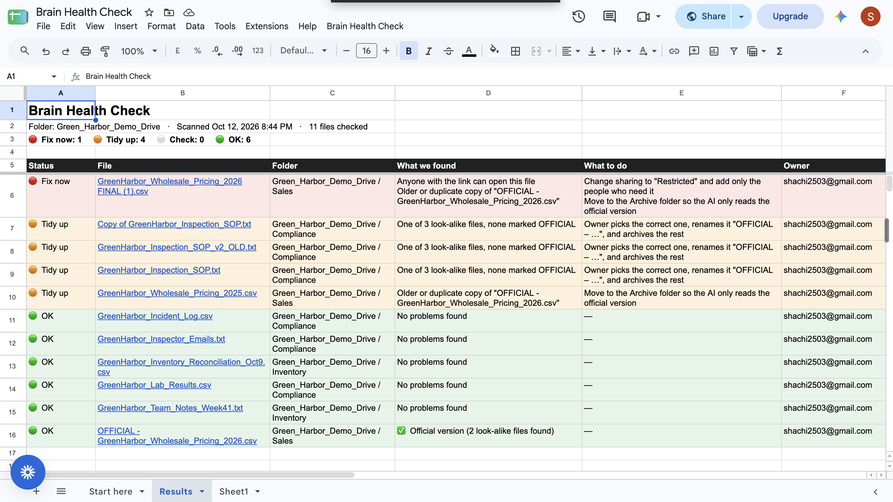

# Brain Health Check

**Try it:** [Google Sheet](https://docs.google.com/spreadsheets/d/10tF07cUHmcB6nPZ2wIb3puViNPiDPHWG8PbCw8S5FkE/edit?usp=sharing) · **Practice folder:** [Google Drive](https://drive.google.com/drive/folders/1qSCKlfOpUcWLfocXgBFUCCqI7POZtWin?usp=drive_link) · **Code:** [github.com/shachi2511/brain-health-check](https://github.com/shachi2511/brain-health-check)

## What it is

A one-click checkup for a Google Drive folder, before our AI assistant (Gemini Enterprise) is allowed to read it.

When an AI reads a messy folder, it can quote an old price or show a private file to the wrong person. This tool finds those problem files, so they can be fixed first.

## What it does to your folder

**Nothing.** It only looks at file names, last-edited dates and who can open each file. It never opens, changes, moves or deletes anything. It flags three things:

- 🔴 **Fix now:** anyone with the link can open the file
- 🟠 **Tidy up:** several versions of the same file (like "Pricing FINAL (1)" and "Copy of Pricing"), so the AI can't tell which one is right
- ⚪ **Check:** not edited in 6+ months, or open to the whole company

## Which folders to check

Any company folder you plan to let the AI read: shared team folders, client folders, and folders with policies, pricing or proposals. It works best on folders with lots of files from lots of people, because that's where duplicates and loose sharing build up.

## Try it in 5 steps

1. **Make your own copy** of the Google Sheet: **File → Make a copy**. The menu only works in your copy.
2. **Open the practice folder,** a fictional company with problems planted on purpose: [Green Harbor practice folder](https://drive.google.com/drive/folders/1qSCKlfOpUcWLfocXgBFUCCqI7POZtWin?usp=drive_link). Copy that link. Or use any real company folder you have access to.
3. **(Optional) Use your own copy of the files:** [download them from GitHub](https://github.com/shachi2511/brain-health-check/archive/refs/heads/main.zip), unzip, and upload **demo-folder → Green_Harbor_Demo_Drive** to Google Drive (**New → Folder upload**).
4. **Run it:** in your copy of the Sheet, click **Brain Health Check** (top menu, after Help) → **Scan a folder…** The first time, Google asks for permission: **Continue** → your account → if it says *"Google hasn't verified this app,"* click **Advanced → Go to … (unsafe) → Allow**. This warning appears because we built the tool ourselves. Then click **Scan a folder…** again.
5. **Paste the folder link** and click **OK**.

## What you'll see

A **Results** tab with a summary at the top (for example: *Fix now 1 · Tidy up 4 · OK 6*), then one row per file, worst first. Each row says what's wrong and what to do, like *"change sharing to Restricted"* or *"move to the Archive folder."* Click any file name to open it.

With the practice folder: 🔴 the "FINAL (1)" price list (anyone can open it, and it's an old copy); 🟠 three versions of the inspection rulebook with none marked official, plus the old 2025 price list; 🟢 everything else, with the official price list marked ✅.

## If something goes wrong

- **No "Brain Health Check" menu?** Reload the page and wait a few seconds. On a view-only link, make a copy first (step 1).
- **"That doesn't look like a Drive folder link"?** You copied a file link. Open the folder itself and copy that link.
- **"I couldn't open that folder"?** You don't have access. Ask the folder's owner to share it with you.
- **A file flagged as a duplicate that isn't one?** Its name looks like another file's. Rename one so the names are clearly different.
